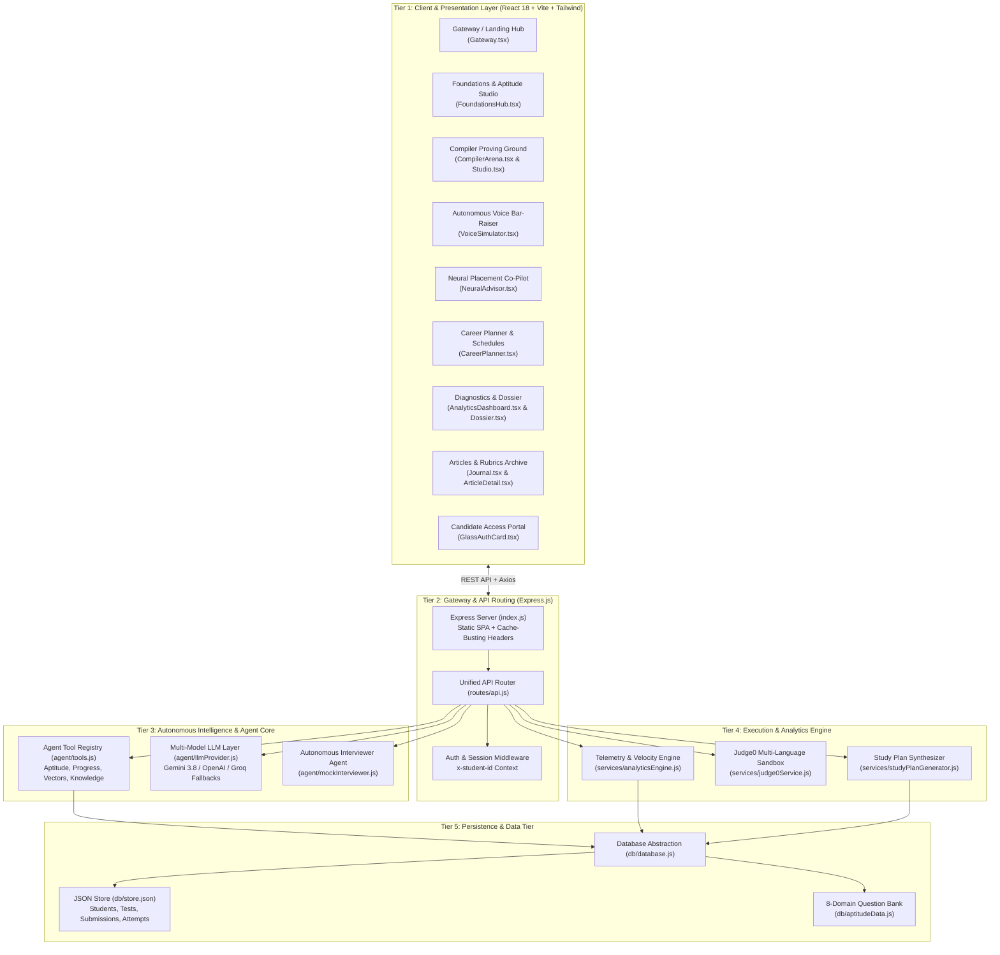

\\# InterviewX // System Architecture & Engineering Blueprint


This document serves as the authoritative architectural blueprint of the **InterviewX (STRATA)** platform. It details the structural topology, component-to-file mapping, end-to-end data pipelines, and operational mechanisms across both frontend and backend layers.

---

## 1. High-Level Architectural Topology

InterviewX is architected as an autonomous placement engineering and interview preparation system. It adopts a modular, decoupled **5-Tier Architecture**:



---

## 2. Directory Structure & File Map ("Which File Is Where")

```
IT-Interview-Practice/
├── package.json                   # Root workspace orchestration
├── ARCHITECTURE.md                # System Blueprint (this file)
│
├── server/                        # Backend Node.js / Express Architecture
│   ├── index.js                   # Application bootstrap, Express server, SPA static serving
│   ├── routes/
│   │   └── api.js                 # Central router mounting all REST endpoints (/api/*)
│   ├── agent/                     # Autonomous Intelligence & Tool Calling Core
│   │   ├── tools.js               # Tool definitions & executors (Aptitude, Knowledge, Telemetry)
│   │   ├── llmProvider.js         # Multi-model LLM abstraction (Gemini / OpenAI / Groq)
│   │   └── mockInterviewer.js     # Autonomous voice interviewer rubric marking engine
│   ├── services/                  # Business Logic & Compute Engines
│   │   ├── analyticsEngine.js     # Telemetry derivation, mastery & weak vector scoring
│   │   ├── judge0Service.js       # Code compilation & remote test-case execution (Judge0 CE)
│   │   └── studyPlanGenerator.js  # Tailored multi-day study schedule synthesis
│   └── db/                        # Persistence & Data Layer
│       ├── database.js            # In-memory + file-backed persistence wrapper
│       ├── aptitudeData.js        # 24 verified questions across 8 quantitative & logic domains
│       └── store.json             # Candidates, tests, attempts, submissions, and articles
│
└── client/                        # Frontend React 18 / Vite SPA
    ├── index.html                 # HTML shell, typography links, theme-color #0B1020
    ├── vite.config.ts             # Bundler configuration, path aliases (@ -> src)
    ├── tailwind.config.js         # Glassmorphic color tokens, radial gradients, animations
    └── src/
        ├── App.tsx                # Client router, QueryClient, AuthProvider, Suspense
        ├── main.tsx               # DOM mount point
        │
        ├── pages/                 # Full-Page Screen Views
        │   ├── Gateway.tsx        # Cinematic landing page with hero, tiles & showcases
        │   ├── FoundationsHub.tsx # Aptitude Studio, CS Core Modules, Sprints
        │   ├── CompilerArena.tsx  # 3,555+ LeetCode problem catalog with search & filters
        │   ├── CompilerStudio.tsx # Monaco editor, live execution sandbox, AI review
        │   ├── VoiceSimulator.tsx # Web Speech STT/TTS autonomous voice mock bar raiser
        │   ├── NeuralAdvisor.tsx  # Proactive placement AI chat co-pilot with tool calls
        │   ├── CareerPlanner.tsx  # Multi-step role, tier & schedule synthesizer
        │   ├── AnalyticsDashboard.tsx # Vector radar charts, entropy diagnosis, next steps
        │   ├── Dossier.tsx        # Placement readiness dossier & verified credential card
        │   ├── Journal.tsx        # Technical articles & company hiring rubrics archive
        │   ├── ArticleDetail.tsx  # Article reader with markdown formatting
        │   └── AuthPage.tsx       # Authentication view mounting GlassAuthCard
        │
        ├── components/
        │   ├── layout/            # Shell & Navigation Components
        │   │   ├── AppLayout.tsx      # Global wrapper: AISaasHeader + Content + Footer + Dock
        │   │   ├── AISaasHeader.tsx   # Glass navbar with dropdowns, smart anchors, auth buttons
        │   │   ├── AISaasFooter.tsx   # Deep navy footer with glowing neon X & smart anchors
        │   │   ├── SpotlightNavbar.tsx# High-visibility alternative top navigation
        │   │   └── CinematicFooter.tsx# Multi-column track & sprint footer
        │   │
        │   ├── ui/                # Core Design System Primitives
        │   │   ├── BrandNeonX.tsx     # Custom SVG Neon X with multi-layer blur & floor glow
        │   │   ├── GlassDock.tsx      # Floating bottom quick-launcher with magnification
        │   │   ├── PageLoader.tsx     # Futuristic spin loader for React Suspense fallback
        │   │   ├── SolarSystemRoadmap.tsx # Interactive planetary orbit curriculum visualization
        │   │   ├── MarkdownContent.tsx# Markdown renderer with code highlighting
        │   │   └── spotlight-navbar.tsx # Spotlight floating pill navigation
        │   │
        │   ├── auth/
        │   │   └── GlassAuthCard.tsx  # Centered single-card login, signup & recovery flow
        │   │
        │   └── cinematic/         # High-Fidelity Showcase Components
        │       ├── AISaasHero.tsx              # Cockpit hero with Neon X, orbits, chat preview
        │       ├── AISaasQuickTiles.tsx        # 4 interactive glass tiles linking to core modules
        │       ├── AISaasSpotlightVideo.tsx    # Video demonstration preview card
        │       ├── AISaasDashboardShowcase.tsx # Multi-layer floating mockups & radar charts
        │       ├── AISaasDataStream.tsx        # Rising vertical cybernetic circuit traces
        │       ├── AISaasFeaturesCarousel.tsx  # 3D interactive feature cards
        │       ├── AISaasWaveBand.tsx          # Cyan & violet light ribbons
        │       ├── NumberedContact.tsx         # Direct contact section (#section-contact)
        │       ├── JournalGrid.tsx             # Featured articles & dispatches grid
        │       ├── TracksTrio.tsx              # FAANG, Unicorn & Prime track breakdown
        │       ├── PortraitCardRail.tsx        # Company tier cards
        │       └── LearningProgression.tsx     # 4-stage learning methodology display
        │
        └── lib/                   # Utilities, State & Contexts
            ├── api.ts             # Axios client with typed API functions
            ├── types.ts           # TypeScript interfaces across all data models
            └── authContext.tsx    # Client auth context (token, current user, login/logout)
```

---

## 3. How the Website Works ("Data Flows & Subsystems")

### A. Foundations & Quantitative Aptitude Studio
1. **Catalog & Telemetry Retrieval**:
   - `FoundationsHub.tsx` queries `GET /api/foundations/aptitude/topics` and `GET /api/foundations/aptitude/telemetry`.
   - The backend routes invoke `tools.getAptitudeTopics` and `tools.getAptitudeTelemetry` in `agent/tools.js`.
   - Telemetry calculates genuine candidate metrics (accuracy %, attempts count, average solve time per question) directly from `store.testAttempts`.
2. **Session Launch**:
   - The student clicks an aptitude domain card (e.g. *Arithmetic & Business Math* or *Speed, Distance & Time*).
   - A pre-launch modal configures batch size (1 to 3 questions) and difficulty level (*Easy*, *Medium*, *Hard*).
   - Calling `POST /api/foundations/aptitude/session` dynamically creates an assessment entry in `store.tests` with questions filtered from `db/aptitudeData.js`.
3. **Interactive Workspace**:
   - Real-time countdown timer with amber alert states.
   - Strategic hint accordion reveals question-specific hints on demand.
4. **Grading & Step-by-Step Mathematical Derivation**:
   - Answers submitted via `POST /api/foundations/sprints/:id/submit`.
   - Telemetry records the attempt, calculates score and correctness per question.
   - Complete step-by-step mathematical solutions and explanations are unlocked.
5. **Targeted Retry Missed Flow**:
   - Clicking "Retry Missed Questions" captures the exact subset of incorrect questions and spins up a dedicated retry session without altering past test history.

---

### B. Algorithmic Proving Ground (Compiler Arena & Studio)
1. **Catalog Browsing (`CompilerArena.tsx`)**:
   - Pulls 3,555+ problems via `GET /api/compiler/problems` with debounced search, company tags (Amazon, Google, Microsoft, Meta), difficulty filters, and pagination.
2. **Coding Sandbox (`CompilerStudio.tsx`)**:
   - Integrated Monaco code editor with multi-language boilerplate (JavaScript, Python, C++, Java).
3. **Execution Pipeline**:
   - Code runs via `POST /api/compiler/run` using `services/judge0Service.js`.
   - Submissions pass through test cases. On submission, `POST /api/compiler/submit` stores the result in `store.codeSubmissions`.
4. **AI Approach Review**:
   - The student can input their theoretical approach. `agent/llmProvider.js` reviews the stated approach against the actual code for algorithmic time/space invariants and edge-case resilience.

---

### C. Autonomous Voice Mock Bar-Raiser (`VoiceSimulator.tsx`)
1. **Simulation Session Initialization**:
   - Student selects track (Technical / Systems / Behavioral) and interviewer persona (Staff SDE & Bar Raiser / Engineering Director).
   - `POST /api/simulator/start` initializes an interview context in memory via `agent/mockInterviewer.js`.
2. **Speech-to-Text & Text-to-Speech**:
   - Web Speech API captures real-time microphone audio and transcribes candidate answers into text.
   - Text-to-Speech vocalizes interviewer responses back to the candidate.
3. **Multi-Turn Adaptive Rubrics**:
   - Each answer is evaluated across 4 dimensions: *Algorithmic Rigor*, *System Architecture*, *Communication Precision*, and *Behavioral Culture Fit*.
   - The agent detects misconceptions or gaps and formulates dynamic follow-up probing questions.
4. **Final Assessment Report**:
   - Synthesizes a structured candidate scorecard highlighting strengths, red flags, and hire/no-hire recommendations.

---

### D. Neural Advisor & Placement Co-Pilot (`NeuralAdvisor.tsx`)
1. **4 Specialized Co-Pilot Modes**:
   - *Ask a question* (Live Query): CS fundamentals, algorithms, system design.
   - *Review code* (Code Audit): Complexity, edge cases, vulnerability analysis.
   - *Learn a concept* (Concept Decompiler): Intuition-first architectural breakdown.
   - *Plan my practice* (Placement Strategy): Telemetry-grounded study roadmap.
2. **Agentic Tool-Calling Pipeline**:
   - When a candidate asks for advice, `llmProvider.js` calls tools in `agent/tools.js`:
     - `searchKnowledge`: Queries the curated InterviewX study library.
     - `getStudentProgressSnapshot`: Reads current test attempts and solved problem counts.
     - `getWeakTopics`: Identifies lagging topics based on scoring entropy.
     - `getRecommendedQuestions`: Recommends targeted practice questions.

---

### E. Career Planner & Diagnostic Engine (`CareerPlanner.tsx` & `AnalyticsDashboard.tsx`)
1. **Career Planner**:
   - 6-step interactive workflow capturing target role, company tier (FAANG, Unicorn, IT Services Prime), geographic market, graduation timeline, and current skill ratings.
   - `services/studyPlanGenerator.js` creates a milestone-driven, multi-week preparation roadmap saved to the candidate's profile.
2. **Performance Analytics**:
   - `services/analyticsEngine.js` calculates **Placement Velocity Index**, **Algorithmic Entropy**, **Systems Core Index**, and **Quantitative Velocity**.
   - Identifies candidate's top mastered vectors and priority weak vectors requiring remediation.

---

## 4. API Endpoints Reference

| Route | Method | Purpose | Source Handler |
| :--- | :--- | :--- | :--- |
| `/api/status` | `GET` | System health, AI provider status & Judge0 connectivity | `routes/api.js` |
| `/api/candidate/profile` | `GET`, `POST` | Candidate profile data & target track | `AnalyticsEngine` |
| `/api/advisor/briefing` | `GET` | Autonomous daily briefing & weak-vector diagnosis | `AnalyticsEngine` |
| `/api/advisor/query` | `POST` | Multi-turn agent chat with tool execution | `agent/llmProvider.js` |
| `/api/compiler/problems` | `GET` | Filtered problem catalog with pagination | `db/database.js` |
| `/api/compiler/problems/:id` | `GET` | Single problem specification and starter code | `db/database.js` |
| `/api/compiler/run` | `POST` | Execute code against sample test cases via Judge0 | `services/judge0Service.js`|
| `/api/compiler/submit` | `POST` | Submit solution, evaluate all test cases, record attempt | `services/judge0Service.js`|
| `/api/foundations/sprints` | `GET` | Full sprint catalog (CS Core + Dedicated Aptitude) | `db/database.js` |
| `/api/foundations/sprints/:id` | `GET` | Sprint questions & time parameters | `db/database.js` |
| `/api/foundations/sprints/:id/submit`| `POST`| Grade sprint, record telemetry, return derivations | `routes/api.js` |
| `/api/foundations/aptitude/topics` | `GET` | 8-domain syllabus topics with question counts | `agent/tools.js` |
| `/api/foundations/aptitude/questions`| `GET` | Filtered aptitude questions by domain/difficulty | `agent/tools.js` |
| `/api/foundations/aptitude/session` | `POST`| Generate on-demand practice session or retry sprint | `agent/tools.js` |
| `/api/foundations/aptitude/telemetry`| `GET` | Real aggregated aptitude accuracy & pace metrics | `agent/tools.js` |
| `/api/simulator/start` | `POST`| Launch autonomous mock interview session | `agent/mockInterviewer.js` |
| `/api/simulator/respond` | `POST`| Submit candidate verbal response & evaluate rubrics | `agent/mockInterviewer.js` |
| `/api/articles` | `GET` | Engineering dispatches & company interview rubrics | `db/database.js` |
| `/api/articles/:slug` | `GET` | Full article content with markdown formatting | `db/database.js` |
| `/api/analytics/profile` | `GET` | Deep telemetry profile & radar charts | `AnalyticsEngine` |

---

## 5. Design System Tokens & Aesthetic Philosophy

InterviewX follows a **Cinematic Neo-Futuristic Glassmorphic** visual paradigm:

* **Background Base**: `#0B1020` (Deep Space Navy).
* **Card Surface**: `#10172D` with `backdrop-blur-xl` and `border border-white/10`.
* **Primary Accents**:
  * Teal / Cyan: `#2DD4D0` (Used for active states, positive metrics, velocity markers).
  * Violet / Purple: `#6D5CFF` and `#8B7BFF` (Used for AI intelligence, brand glow, orbital paths).
  * Electric Blue: `#4A72FF` (Used for primary action gradients).
  * Amber: `#F59E0B` (Used for timers under pressure, behavioral badges).
* **Typography**:
  * Headings: **Sora** & **Inter** (`font-heading font-bold text-white tracking-tight`).
  * Body: **Inter** (`text-slate-300 font-sans leading-relaxed`).
  * Telemetry / Badges / Timers: **JetBrains Mono** (`font-mono text-xs uppercase tracking-wider`).
* **Interactive Accents**:
  * Multi-layer radial glow gradients (`bg-[#6D5CFF]/15 blur-[120px]`).
  * Glowing Neon X brand element with floor reflection.
  * Magnetic proximity dock launcher (`GlassDock.tsx`).

---

## 6. Build, Deployment & Production Serving

* **Client Bundler**: Vite 8.3 (`vite build` compiles into `client/dist/` in ~300ms).
* **Type Safety**: TypeScript 5 (`tsc -b --noEmit` validates all components and contracts).
* **Production Serving**: Express.js in `server/index.js` serves `client/dist/` as a static Single-Page Application (SPA).
* **Zero-Stale Caching**: HTML responses are served with `Cache-Control: no-cache, no-store, must-revalidate` so that client updates are picked up instantly without stale chunk errors.
* **Fallback Routing**: Any unmatched server route rewrites to `client/dist/index.html` to support direct deep linking across all 15 React Router paths.
